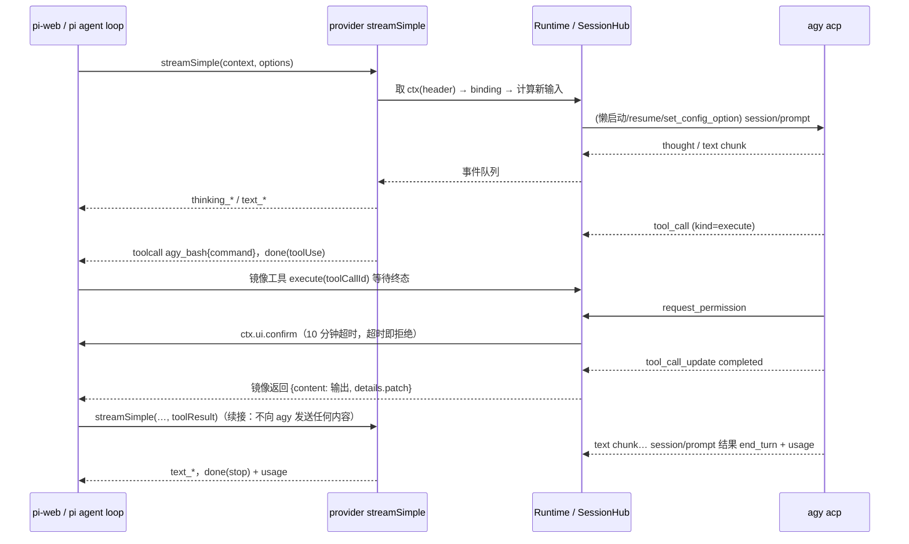

# pi-agy-acp 设计文档

本文记录设计决定和实现状态（2026-11-22）。调研过程见 [research/](research/README.md)，评审记录见 [review-2026-11-22.md](review-2026-11-22.md)。

目标：做一个 pi package，把官方 `agy acp`（实测版本 1.5.14）接成 pi 的 provider，重点是在 pi-web 里用起来舒服。
依据：[调研汇总](research/README.md)、[agy 实测](research/agy-acp-handshake.md)。

## 0. 关键决定

| # | 决定 | 结论 | 代价 / 备选 |
|---|---|---|---|
| D1 | agy 执行的工具在 pi-web 里怎么显示 | **只读镜像工具**：provider 发出 `agy_bash` / `agy_edit` / `agy_write` / `agy_read` / `agy_tool` 这几种 toolCall，对应的 pi 工具只等待 ACP 的结果，从不重做操作。这样 pi-web 能显示原生命令卡和并排 diff | pi 的历史里会留下合成的 toolCall 和 toolResult；一个 ACP turn 会被拆成多条 pi assistant 消息。备选是写进正文或 thinking，实现简单，但显示效果差 |
| D2 | 进程模型 | **每个 pi 进程（pi-web server 或 TUI）共用一个 `agy acp`**，多个会话复用这个进程；空闲 10 分钟后退出。模型是按 ACP 会话设置的，所以共用一个进程也能同时跑多个模型。实测：同一个进程里，会话 A 用 flash、会话 B 用 claude-sonnet，同时各跑一个 `sleep 6` 工具，两个都在约 10.5 s 内完成，执行时间是重叠的 | 进程崩溃会影响所有会话（之后会自动 resume）。备选：`extraArgs: ["--process-per-session"]`，由 agy 自己按会话拆分 worker 进程 |
| D3 | 权限 | **完全放行**（v0.3 改）：自动回复 `allow_once`，没有审批模式，也没有开关；agy 主动提问时照常弹窗让用户回答 | 和 pi、T3 的 Full access 一致 |
| D4 | 发给 agy 的内容 | **只发用户输入和图片**。不发 pi 的 system prompt，也不用 `systemPrompt.append` | agy 的约束由用户写在 agy 自己的规则文件里：项目级的 `AGENTS.md`/`GEMINI.md`/`.agents/rules/`，全局的在 `~/.gemini/` 下 |
| D5 | fork、分支不一致或会话丢失时怎么接上 | 新建 ACP 会话，把**有界的历史转录**（默认 6 万字符，带明确标记）放在第一条 prompt 前面 | agy 原生的上下文（之前读过的文件等）不会带过去。备选：不 replay，从空白开始 |
| D6 | 命名 | provider id 定为 **`antigravity`**，模型 id 用 agy 的基础模型 value（如 `antigravity/gemini-4-neon`），思考档位走 pi 的 thinking level。管理命令用较短的 `/agy` | 使用 `enabledModels` 时需要把这些模型加进去 |
| D7 | steering | 用户在运行中发消息时，**立即**作为新的 `session/prompt` 发给 agy（原生 steer），pi 这边在下一个边界插入这条用户消息 | 实现比“等 turn 结束”复杂一档；如果出问题可以退回到只在工具边界投递 |

## 1. 架构

```
pi-web Node 进程（多个 AgentSession）
 ├─ 扩展实例 × N（每个会话加载一次 factory）
 │    ├─ provider "antigravity"  streamSimple：pi 上下文 → ACP prompt → pi 事件流
 │    ├─ 镜像工具 agy_*     execute：等待 ACP 工具终态 → 结果 + diff
 │    ├─ 命令 /agy（管理用）
 │    └─ 事件：before_provider_headers（关联 ctx）、input（steer）、session_shutdown
 └─ globalThis[Symbol.for("pi-agy-acp")]  共享 Runtime（跨扩展实例只有一份）
      ├─ AgyProcess   懒启动 `agy acp`，独立进程组，崩溃后标记重启
      ├─ AcpConnection  NDJSON JSON-RPC，双向请求，pending 在退出时全部 reject
      ├─ SessionHub   acpSessionId → 事件队列、当前 turn、工具状态表、配置缓存
      ├─ BindingStore ~/.pi/agent/pi-agy-acp/bindings/<piSessionId>.json
      ├─ Catalog      ~/.pi/agent/pi-agy-acp/catalog.json（模型、档位、slash 命令、版本）
      └─ DebugLog     ACP_DEBUG 抓包
```

源码布局（TypeScript，pi 通过 jiti 直接加载，不需要构建步骤）：

```
src/index.ts        入口：注册 provider、工具、命令、事件
src/acp.ts          JSON-RPC over stdio + 进程生命周期
src/runtime.ts      共享 Runtime、SessionHub、turn 引擎
src/provider.ts     streamSimple
src/mirror.ts       ACP tool_call → pi toolCall 参数、结果和 diff
src/bindings.ts     映射持久化 + 锚点匹配
src/catalog.ts      模型目录缓存 → pi 模型定义
src/replay.ts       pi 历史 → 有界文本转录
src/debug.ts        抓包与脱敏
test/fake-agent.ts  可编排的假 ACP agent
test/*.test.ts      node --test（Node 24 原生剥离类型）
```

## 2. 一轮对话的时序



## 3. 逐条功能设计

### 3.1 会话映射、恢复和 fork

**取得会话身份。** 先用 `before_provider_headers` 拿到当前会话的 ctx：只在 `ctx.model.provider === "antigravity"` 时，往 headers 里写一个内部令牌，并在共享表里登记“令牌 → ctx”。streamSimple 从 `options.headers` 取出令牌，就能找到真实的 pi session id、cwd、`ctx.ui` 和 header 里的 parentSession。这个令牌不会发给 agy（agy 不走 HTTP）。

这样做能绕开 pi-web side chat 把 `options.sessionId` 设成主会话 id 的问题。拿不到 ctx 的请求（压缩、摘要等维护类调用）走一次性的临时 ACP 会话，用完就 `session/close`。`disableContinuation` 的缓存预热请求直接返回空结果，不发给 agy；我们本来也不声明 promptCache。

**持久化。** 每个 pi 会话一个旁路文件：`~/.pi/agent/pi-agy-acp/bindings/<piSessionId>.json`。

```jsonc
{ "v": 1, "piSessionId": "…", "bindings": [ {
  "acpSessionId": "…", "cwd": "…", "createdAt": 0, "lastActive": 0,
  "responseIds": ["agy:<acp8>:<n>", …],   // 本 ACP 会话产出的 pi assistant 消息（保留最近 200 条）
  "delivered": ["<sha256 前 16 位>", …],   // 已经直接发给 agy 的用户输入（steer 去重用）
  "config": {"model":"gemini-4-neon","thought_level":"high","mode":"default"}
} ] }
```

每个 pi 会话最多保留 5 个 binding，对应 `/tree` 的不同分支。文件写入用 tmp 文件加 rename；超过 60 天的文件在启动时清理。不用 `pi.appendEntry`，理由是：fork 会把 entry 复制到新会话，而 provider 拿不到可写的 session。

**锚点匹配（替代整段前缀 hash）。** provider 产出的每条 assistant 消息都设置 `responseId = "agy:<acp8>:<seq>"`。每次请求时：

1. 在 context 里找最后一条 `responseId` 以 `agy:` 开头的 assistant 消息，把它当作锚点。
2. 在本会话的各个 binding 里找包含这个锚点的那一个。如果锚点之后、本 binding 还产出过别的消息，那些消息必须都是 error 或 aborted 类型（pi 不会把这类消息重放进 context），否则视为分支不一致。
3. 锚点之后的消息就是“新输入”：
   - 跳过本 binding 发起的镜像 toolResult。
   - user 消息转成 ACP 内容块。
   - 其他模型的 assistant 消息、toolResult 转成简短的文字说明，例如“〔中途由 claude-opus 回答：…〕”。这样用户中途换成 Claude 回答一轮，再切回 agy 时，agy 也能知道发生了什么。
   - 已经在 `delivered` 里的用户输入不再重复发送。

这套规则覆盖的情况：

- pi 压缩：压缩会保留最近的消息，锚点还在，ACP 会话不受影响，agy 自己的完整上下文也保留着。
- `/tree` 在分支之间来回切：切回去时，原分支对应的 binding 还在。
- 用别的模型插话：见上面第 3 步。
- 编辑旧消息后重发：锚点变成更早的一条，判定为分支不一致，新建 ACP 会话并做 replay。

**冷启动接回会话**（重启 pi-web 或 `/resume`）：

1. 先 `session/list`，确认 `acpSessionId` 还存在（实测 load 一个不存在的 id 也会成功，所以必须先查）。
2. 存在就调用 `session/resume`，不回放历史。
3. resume 之后按顺序重新设置 model、thought_level（实测 resume 会把它们重置为默认值）。
4. 会话不存在或 resume 失败时，新建会话并做 replay，同时 `ctx.ui.notify` 提示“原 agy 会话已失效，已用历史重建”。
5. 不用 `session/load`，因为它的历史回放对我们没有用处。如果以后需要在 pi 里导入 agy 的原生会话，再考虑它。

**fork**：pi-web 的 fork 或 `/clone` 会生成新的 pi session id。新 id 没有 binding，所以在**第一次发送消息时**懒创建新的 ACP 会话，并把 fork 点之前的历史做有界 replay。绝不和父会话共用同一个 ACP 会话，因为两边会互相污染。agy 不支持 `session/fork`。

**replay 格式**（只在新建 ACP 会话、且 pi 已有历史时才会发）：

```
<pi_conversation_history note="以下是此前在 pi 中的对话转录，仅供参考，其中的操作都已完成，不要重复执行">
[user] …
[assistant] …
[tool agy_bash] $ ls -la → exit 0（输出截断）
…
</pi_conversation_history>

<用户本条消息>
```

总长度默认不超过 6 万字符：优先保留最近的内容，较早的部分按条截断，图片用占位符代替，只有最新一条 user 消息里的图片会按原样发送。

### 3.2 流式输出在 pi-web 里的显示

| ACP 事件 | pi 中的表现 |
|---|---|
| `agent_thought_chunk` | `thinking_*`，折叠显示 |
| `agent_message_chunk` | `text_*`，Markdown 渲染。`file:///abs` 链接原样保留 |
| `tool_call`（第一次出现某个 id） | 结束当前 assistant 消息，生成镜像 toolCall，`done(toolUse)`。连续到达、中间没有文字的多个 tool_call，在 **150 ms 窗口**内合并进同一条消息，pi 会并行执行这些镜像，对应的卡片同时显示为“运行中” |
| `tool_call_update` | 直接由 Runtime 合并进工具状态表（**不经过** streamSimple，避免死锁），镜像 execute 通过 `onUpdate` 刷新状态，收到终态时 resolve |
| `plan` | 镜像卡 `agy_todo`，结果是 Markdown 勾选清单；同一个 turn 内内容没变就不重复出卡（实测还没见过 agy 发这个事件） |
| `session_info_update.title` | 如果 pi 会话还没有名字，用 `pi.setSessionName` 设置（只设置一次） |
| `usage_update` | 记下 `used` 和 `size`，用于用量（见 3.12）和该模型的 contextWindow |
| `available_commands_update` | 更新 slash 命令（见 3.7） |
| `current_mode_update` / `config_option_update` | 更新配置缓存 |

**镜像工具的形状**（为了匹配 pi-web 现有渲染器的约定）：

| agy kind / name | pi toolName | arguments（pi-web 的显示） | 结果 |
|---|---|---|---|
| execute（run_command） | `agy_bash` | `{command}`，显示为命令卡，可复制 | 去掉 "Created At…Command output:" 前缀后的输出；`exit_code≠0` 或 failed 时 `isError` |
| edit，同时有 oldText 和 newText（edit_file） | `agy_edit` | `{path, oldText, newText}` | `details.patch` 为统一 diff，pi-web 显示为并排 diff |
| edit，只有 newText（write_file） | `agy_write` | `{path, content}`，显示写入的内容 | `details.patch`（`/dev/null` → 新文件） |
| read | `agy_read` | `{path}`，可以打开文件 | 截断到 2 万字符 |
| search / fetch / think / other / MCP | `agy_tool` | `{title, kind, ...rawInput 里的简单字段}` | content 里的文本 |
| plan | `agy_todo` | `{entries}` | 勾选清单 |

补充说明：

- **diff 行号**：agy 给的是片段，不是整个文件。工具完成后，读一次当前文件内容，定位 newText 的位置，算出 `@@` 的行号；定位不到时就用片段 diff，并在 details 里标注“行号未知”，不伪造行号（T3 的做法）。diff 由一个很小的内置函数生成，没有运行时依赖。
- **工具 schema**：全部是宽松的 object，镜像不使用参数，只按 toolCallId 查找状态。
- **toolCallId**：沿用 ACP 的 id；内部状态表的键是 `(acpSessionId, toolCallId)`。
- **对模型隐藏**：用 `prepareLoadout` 返回 `hiddenDeclarations`，让镜像工具仍然可以执行，但不出现在任何模型的工具声明里，所以 Claude 等其他模型看不到它们。实现时第一项测试就要验证这一点；如果不可行，退回到“只在当前模型属于 agy 时才激活这些工具”。
- **镜像的结束条件**：
  - 工具到达终态，正常返回。
  - daemon 或定时任务（`IsDaemon: true`、schedule）在 agy 结束这一轮时还在运行：返回“Still running in the background”，不标成成功。
  - 进程退出时返回错误。
  - pi 中止时发送 `session/cancel`，返回 aborted。
- **后台命令（v0.4）**：agy 的 `run_command` 超过 `WaitMsBeforeAsync` 后会转到后台，prompt 先以 `end_turn` 返回；命令跑完后，agy 会**不经 prompt 主动汇报**，以若干 chunk 加 `usage_update` 结束（实测见 `docs/research/agy-acp-handshake.md`）。处理方式和 pi 自己的 `bash` 一致：
  - **非 daemon 命令占住回复**：prompt 返回时如果还有这类命令在跑，turn 不结束，镜像卡片一直显示运行中。命令结束、agy 的汇报流进同一条回复，然后 agy 静默 3 秒即结束（命令结束后 20 秒内 agy 没开口也结束）。期间按停止会发 `session/cancel`（agy 会终止后台命令），并立即结束回复。
  - **daemon 和定时任务不占住回复**。之后 agy 如果主动开口，而 pi 里没有进行中的回复，插件用一条 `agy-wake` 自定义消息触发一轮新回复，把 agy 的话流式显示出来，不需要等用户发下一条消息。这条消息通过 pi 的 `context` 钩子从所有模型请求里剔除（按 customType 判断，不按文字）。pi 正忙时以 follow-up 排队。
  - 用户按了停止之后，agy 再说的话不会自动开新回复，再来的权限请求一律拒绝，直到用户下一次发消息。
  - 在 agy 主动汇报期间新启动的 daemon，也不占住回复；agy 主动提问时，回复会等用户回答，不会因为静默而结束。

### 3.3 模型和思考档位

- **来源**：`configOptions`，`model` 取它的 select 选项；`thought_level` 按模型逐个探测（实测见 handshake §2）。
- **探测**：第一次真正启动进程之后（或 agy 版本变化、超过 24 小时、执行 `/agy models refresh` 时），在后台开一个临时会话，依次对每个模型调用 `set_config_option`，读出它的 thought_level 选项，然后 close 这个会话。这一步只走配置 RPC，不消耗额度。
- **缓存**：结果写进 `catalog.json`，内容是 `{agyVersion, fetchedAt, tier, models:[{id,name,levels[],contextWindow}], commands:[…]}`。
- **离线启动**：factory 同步读取 catalog 并注册 provider，**factory 不会拉起 agy**。没有缓存时，用今天实测的 9 个模型作为内置种子。目录更新后重新 `registerProvider`；pi-web 的模型列表最多 60 秒后刷新。
- **映射到 pi**：
  - 有 thought_level 的模型：`reasoning: true`，`thinkingLevelMap = {off:null, minimal:null, low:"low", medium:"medium", high:"high", xhigh: 支持时为 "xhigh" 否则 null, max:null}`。
  - 没有 thought_level 的模型：`reasoning: false`。
  - pi 选中某个档位后，`options.reasoning` 会给出 pi 的档位值，provider 用 `set_config_option(thought_level)` 设置；值和缓存一致时不重复发送。
  - 如果 `off: null` 没法排除 off 档，就把 off 映射到 low，并在 README 里说明。
- **其他字段**：`input: ["text","image"]`；`contextWindow` 用观察到的 `usage_update.size`，默认 1048576；`maxTokens` 设为 65536（仅供 pi 计算用）；`cost` 默认为 0；用户在 `models.json` 的 `modelOverrides` 里填了价格时，按 3.12 计算费用。
- **auth**：用 `createProvider` 写原生 Provider，`auth.apiKey.resolve` 在找到 agy 可执行文件时返回 `{auth:{}, source:"Antigravity CLI"}`。不需要伪造 key，pi 的模型列表也会把它当作“已配置”。

### 3.4 图片

- 只取锚点之后那些 user 消息里的 `ImageContent`，按顺序转成 `{type:"image", mimeType, data}`。
- 前提是握手时 `promptCapabilities.image === true`，且 MIME 是 png、jpeg、webp 或 gif。不满足时换成文字占位“〔图片未发送：格式不支持〕”。
- 单张超过 10 MiB 的也换成占位。pi-web 和 pi SDK 已经限过尺寸。
- replay 里的历史图片只保留占位，不重新发送。

### 3.5 取消

- pi 的 `options.signal`（streamSimple）或镜像 execute 收到的 signal 被中止时，发送 `session/cancel` 通知。
- 然后最多等 10 秒，等 prompt 返回（通常 stopReason 是 `cancelled`，也可能是 end_turn）。期间新到的事件丢弃。
- 结束时发 `error(aborted)`。正在等待的权限请求一律回 `{outcome:"cancelled"}`。
- 10 秒内没有收尾：把这个 ACP 会话标记为不可信，下一轮先 `session/close` 再 resume，不在这个会话上继续发送内容。

### 3.6 Steering（运行中继续发消息）

实测 agy 原生支持：同一会话再发一次 prompt，旧 prompt 会立刻 end_turn，生成过程无缝接上。

1. 用户在 pi-web 里发送 steer 时，`input` 事件（`streamingBehavior === "steer"`）会带着 ctx 立即触发。如果这个会话正有一个 ACP turn 在跑，**马上**把内容发给 agy（`session/prompt`，图片也一起发），并把内容的 hash 记进 `delivered`。
2. provider 在当前位置结束这条 assistant 消息（`done(stop)`）。pi 在 turn 边界插入这条 steer 用户消息，然后再次调用 streamSimple。provider 发现这条新输入已经发送过，就**不再发送**，直接接着消费同一个 ACP 会话的事件流。这样 pi 历史里的顺序是正确的：`[assistant 前半段] [你的 steer] [assistant 后半段]`。
3. 旧 prompt 提前返回的 end_turn 只结束它自己那个 RPC，不算作这一轮结束；这一轮的结束以最新那个 prompt 的结果为准。
4. 竞态兜底：如果 pi 刚好已经结束了这次 run，随后用 steer 开了一个新 run，streamSimple 的逻辑同样成立（已发送的内容不重发，继续读事件流；已经缓存的事件照常吐出）。
5. follow-up（排队，不打断）：不做特殊处理，pi 会在这一轮结束后把它当作新输入交给 provider，provider 正常发送。

### 3.7 agy 的 slash 命令（v0.3 改：不注册）

定位：在 pi 里**使用 Antigravity 的模型**，而不是在 pi 里套一个 Antigravity 客户端。所以不往 pi 的命令面板里注册 agy 的命令，也不提供 `/agy mode`。

- pi 不认识的 `/xxx` 会原样作为文本发给 provider。所以在 agy 模型下直接输入 `/goal …`，agy 照样能收到并展开（有 e2e 测试）。和 pi 自己的命令或 prompt 模板重名的（如 `/compact`）由 pi 处理。
- agy 的 skills 和规则由 agy 自己按需加载，不需要我们转发。
- 管理命令只保留 `/agy`：

| 子命令 | 作用 |
|---|---|
| `status` | 版本、tier、进程 pid、当前绑定的会话 |
| `models refresh` | 重新探测模型目录 |
| `login` | 见 3.10 |
| `new` | 放弃当前 ACP 会话，下次发送时新建 |
| `debug on\|off` | 开关抓包 |
| `restart` | 杀掉并重启 agy 进程 |

### 3.8 权限

**完全放行，和 pi、T3 的默认 Full access 一致（D3）。没有审批模式，也没有开关。**

- 收到 `session/request_permission` 时，直接回复 agy 给出的 `allow_once`（没有这一项时用 `allow_always`）。工具卡上不额外标注。
- 维护类请求（比如压缩时开的临时会话）回 `reject_once`，确保这类请求不会执行任何工具。
- 没有使用 `--dangerously-skip-permissions`：效果相同，但这样能在抓包里看到每一次放行。
- agy 主动**提问**（`interaction_*`，让用户在几个选项里挑一个）不算审批，仍然弹出 `select` 让用户回答，10 分钟内不选就算取消。

### 3.9 进程管理

- **懒启动**：factory 和模型列表都不会启动 agy；第一次真正的请求或 `/agy` 子命令才会。
- **启动参数**：`spawn(agyPath, ["acp"], {cwd: homedir, detached: true, stdio: pipe})`。
  - `detached: true` 让 agy 拥有独立的进程组，pgid 等于它的 pid。
  - 环境变量继承当前进程，但去掉 `PI_*`（不把 pi 的会话信息泄露给 agy 运行的命令）和 `NODE_OPTIONS`（pi-web 的 proxy bootstrap 不该注入到 agy 的 node 子进程里）；代理变量保留。
  - agyPath 的查找顺序：配置项 → `PI_AGY_BIN` → PATH 里的 `agy` → `~/.local/bin/agy`。
- **复用**：整个 pi 进程共用一个 agy 进程（挂在 `globalThis` 上），多个会话靠 sessionId 复用它。`initialize` 只做一次，结果缓存下来。model、thought_level 和 mode 都是**按 ACP 会话**设置的，所以不同的 pi 会话可以同时用不同的模型并行工作（已实测，见 D2）。
- **崩溃**：进程 `exit` 时，所有 pending RPC 都 reject；正在进行的 turn 结束为 `error`，提示“agy 进程退出（code/signal），下次发送会自动重启并接回会话”；所有 binding 标记为需要 resume。**不自动重发**那条 prompt，因为它可能已经产生了副作用。下一次请求时再重新拉起进程。
- **卡死保护**：一个 turn 在 10 分钟内没有任何事件，且没有正在进行的工具或待处理的权限请求时，判定为卡死：发 cancel，并以 error 结束。
- **空闲退出**：没有活动 turn、超过 10 分钟没有请求时，先 `session/close` 关闭所有会话，再结束进程。
- **退出清理**：
  - 正常路径：`session_shutdown`（最后一个实例退出时）→ 关闭会话 → 关闭 stdin → 对进程组发 `SIGTERM`（`kill(-pgid)`）→ 2 秒后还在就 `SIGKILL`。
  - 兜底：在 `process.on("exit")` 里同步执行 `kill(-pgid, SIGTERM)`。
  - 如果 pi 被 SIGKILL：stdin 的管道会断开，实测 agy 会因此自己退出。
- **不碰别人的进程**：只向自己拉起的那个 pgid 发信号，不用 `pkill`，不扫描进程名。`~/.antigravity-hub-server` 是另一个独立的进程树，实测 agy acp 不会连接它。

### 3.10 未登录和错误提示

- **发现未登录**：`session/new`、`list` 或 `resume` 返回 `-32000`，或者 `-32603` 且错误信息以 "No browser is available" 开头。这时这一轮以 error 结束，提示：
  > Antigravity 未登录。运行 `/agy login` 按提示完成 Google 登录；或在终端执行 `agy` 登录后重试。
  
  同时调用 `ctx.ui.notify(..., "error")`。错误文案会避开 pi 自动重试会匹配的那些字样（实现时对照 pi-ai 的 retry 规则确认），防止重复调用。
- **`/agy login`**：
  1. 运行 `agy acp --login`，环境里去掉 `DISPLAY` 和 `WAYLAND_DISPLAY`，让它打印登录链接，而不是尝试打开本地浏览器。
  2. 从输出里提取 Google 授权链接，用 `ctx.ui.input` 弹框：标题里放这个链接，用户打开、授权后把授权码粘贴回来。
  3. 把授权码写进它的 stdin，等进程退出。
  4. 重启共享进程，并用 `session/list` 验证登录是否成功。
  
  全程只使用官方的登录流程，不读取也不复制 token。输出的具体格式会在实现时用临时 HOME 实测确认，不会碰已经登录的 profile。
- **其他错误**：
  - 找不到 agy 可执行文件：提示安装方式。
  - 配额或 429（RESOURCE_EXHAUSTED、QUOTA_EXHAUSTED）：原文显示，不自动重试。
  - 进程退出：见 3.9。
  - 未知的 JSON-RPC 错误：显示 `code` 和 `message`。

### 3.11 ACP_DEBUG 抓包

- **开启方式**：`ACP_DEBUG=1`（或者直接给一个文件路径），也可以用 `/agy debug on` 在运行时开启。
- **格式**：每帧一行 NDJSON，`{t, dir:"out"|"in"|"stderr"|"spawn"|"exit", piSessionId?, msg}`，写到 `~/.pi/agent/pi-agy-acp/logs/acp-<日期>-<pid>.ndjson`。开启时会通过 notify 显示文件路径。
- **脱敏**：图片的 base64 换成 `<image/png 12345B sha256:…>`；不记录环境变量；文件权限 0600。
- **pi 侧可见**：发送 `session/prompt` 之前，先 `await options.onPayload(params)`，所以 pi 自带的 debug-provider 等工具也能看到实际发出去的内容；每条 session/update 也会经过 `onProviderStreamEvent`。
- **核对用的辅助命令**：`npm run acp:tail` 只打印 `out` 方向的帧，方便检查“发给 agy 的内容是否干净”。

### 3.12 用量

- 在 ACP turn 的**最后一条** pi 消息上写用量，中间那些 toolUse 消息都写 0：
  - `cost` = `calculateCost(model, 计费累计)`，计费累计取 prompt 结果里的 `inputTokens` / `cachedReadTokens` / `cachedWriteTokens` / `outputTokens`，是这一轮所有内部调用之和；`outputTokens` 已含 `thoughtTokens`；价格取模型定义（含用户的 `modelOverrides`）；
  - `totalTokens` = 最后一次 `usage_update.used`，即上下文占用；
  - `input` / `cacheRead` / `cacheWrite` = 把计费累计的三项按比例缩放到 `totalTokens`（保留缓存命中比例）；`output` 保持计费值。
- 原因：pi 把单条消息的 `input + cacheRead` 当成一次请求的 prompt。若写入整轮累计，长回合会超过上下文窗口，被 pi 的静默溢出检查误判并触发压缩；写进 `totalTokens` 则会污染上下文估算（Zac #80 的教训）。代价是 token 分项不再是计费口径，费用仍是。
- 没有 `usage_update` 的 turn（如 agy 自己的 `/compact`）不记用量：只有计费值时，pi 会把各项之和当成上下文占用。以下情况只会少算、不会多算，属于已接受的限制：被 steer 接管的 prompt 没有 usage；agy 已结束但 pi 带着新输入另开 turn、或在后台等待期间 steer/停止时，前一个 prompt 的 usage 会被丢弃；回合中途在 pi 切换模型时，续接消息按新模型记名和计价；分档价格按整轮累计量选档（拿不到逐次调用的数）。

## 4. 发给 agy 的内容（干净性约定）

1. **会出现在 `session/prompt` 里的内容**：
   - 用户这一轮的文字和图片；
   - 中途其他模型回答的简短说明（3.1 第 3 步）；
   - 必要时的 replay 转录（3.1，有明确标签）；
   - slash 命令的原文。

   除此以外没有别的。
2. **`session/new` 的参数**：`{cwd, mcpServers: []}`，不带 `_meta`。
3. **不会发送的**：pi 的 system prompt、工具清单、skills、AGENTS.md、时间戳、pi 内部 id。
4. **`initialize` 的参数**：`clientInfo` 如实写 `pi-agy-acp/<version>`；`fs` 和 `terminal` 都声明为 false，agy 用它自己的工具。
5. 以上全部可以通过 ACP_DEBUG 的 `out` 帧逐条核对。

## 5. 配置

用 `~/.pi/agent/pi-agy-acp/config.json`，可选，全部有默认值：

```jsonc
{ "agyPath": null, "extraArgs": [] }
```

replay 上限（6 万字符）、空闲退出（10 分钟）、卡死保护（10 分钟）、取消等待（10 秒）都是代码里的常量，没人需要调就不做成配置。

`extraArgs` 留给 `--disable-telemetry`、`--sandbox`、`--process-per-session` 这类参数，默认为空。

## 6. 测试计划

**假 agent**（`test/fake-agent.ts`）：用 Node 写的 NDJSON 进程，按场景文件（JSON）编排，能做这些事：

- initialize 返回 agy 1.5.14 形状的 capabilities；
- new / list / resume / close / set_config_option，并且实现“resume 后配置重置”；
- 脚本化的 thought、text、tool_call、tool_call_update（包括 diff 和 execute 输出）、plan；
- 反向发起 request_permission；
- cancel 后把工具标成 failed，并回 `cancelled`；
- 第二个 prompt 取代第一个（steer）；
- 未登录时返回 -32000；
- 指定时刻退出（模拟崩溃）；
- 拉起一个孙子进程（用来测进程组清理）；
- 把收到的所有帧写到日志里，供断言使用。

| 层 | 覆盖 |
|---|---|
| 单元 | JSON-RPC 分帧和双向请求；ACP 事件 → pi 事件，包括 index 配对和唯一的终止事件；diff 生成；锚点匹配和 delivered 去重；replay 截断；权限选项映射 |
| 集成（provider + 假 agent） | 文本和思考流；tool → toolUse → 镜像 resolve → 续接；150 ms 内的并行合并；权限的允许、拒绝、超时、无 UI；取消；steer 不重发；进程重启后 resume 并重新设置配置；list 里没有该会话时 replay；未登录提示；崩溃不自动重发；进程组清理后不留孙子进程 |
| pi SDK 端到端 | 用 `createAgentSessionServices` 在进程内跑真实的 agent loop：验证镜像工具对模型隐藏但可以执行、toolResult 续接、fork 后新建 ACP 会话、压缩后保留 ACP 会话、responseId 能保存到下一轮 |
| 真机冒烟（手动，`npm run smoke`） | 真实的 agy，flash + low：一次带工具的对话；重启后 resume；图片；取消；steer |
| pi-web 目测 | 在隔离的 pi-web 实例里截图核对：命令卡、diff、思考折叠 |

## 7. pi-web 改动建议（只列出来，不会去改）

| 优先级 | 建议 | 不改的影响 |
|---|---|---|
| P1 | side chat 把 `agent.sessionId` 改成父会话 id（`lib/rpc-manager.ts:3120-3124`），对有状态的 provider 来说身份会出错。建议在 `options.metadata` 里另外带上真实的 session id，或者对声明 `stateful` 的 provider 不做覆盖 | 已经用 header 关联 ctx 规避了；如果在 side chat 里用 agy，会走临时会话或者看不到主会话的上下文 |
| P2 | 工具卡支持 `details.title`（或 label）覆盖显示名，这样能显示 agy 的标题，比如 "File hello.txt"，而不是 `agy_edit` | 卡片头部显示 `agy_edit` 加路径预览，可以接受 |
| P2 | 渲染 `setStatus`，在 composer 旁边显示一行 agy 状态：mode、后台任务数、tier | 状态只能通过 `/agy status` 和 notify 查看 |
| P3 | 在 `activeToolResults` 白名单里加入 `agy_bash`，支持命令输出的增量显示 | agy 本身不流式输出命令结果，目前没有实际影响 |
| P3 | 模型目录变化时通过 SSE 推送给 picker | 最多要等 60 秒 |

## 8. 合规自检清单

实现和发布前逐项打勾：

- [ ] 只调用用户机器上官方安装的 `agy` 和它公开的 `agy acp` 子命令；不下载或捆绑 `.par`，不替换、不修补 agy 的二进制和数据文件。
- [ ] 登录只走官方流程（`agy` 或 `agy acp --login`）；不读取、复制、导出或上传 `~/.gemini` 下的任何凭据或 token；不实现多账号轮换。
- [ ] `clientInfo` 如实写 `pi-agy-acp`，不冒充 zed、IDE 或其他客户端。
- [ ] 不读取或修改 agy 私有的 SQLite、对话库和 brain 目录。
- [ ] 权限走 agy 自己的 `request_permission` 流程，由客户端应答：按用户的决定完全放行（D3），只回 `allow_once`；维护类临时会话回拒绝；不改 agy 的权限配置。
- [ ] 不向 agy 注入隐藏指令：prompt 里只有第 4 节列出的内容，并且可以通过 ACP_DEBUG 核对。
- [ ] 不规避配额和限流：遇到 429 或配额错误不自动重试、不循环重试，原样告知用户；模型探测只用配置 RPC，不发 prompt。
- [ ] 只管理自己拉起的进程组；不碰 `~/.antigravity-hub-server`、`language_server` 或其他 agy 进程；退出时清理干净（有测试覆盖）。
- [ ] 不把 pi 的环境（`PI_*`）和会话信息泄露给 agy 执行的命令。
- [ ] 抓包默认关闭；开启后对图片脱敏、文件权限 0600、不记录环境变量，也不记录任何凭据。
- [ ] 不修改 agy 的遥测设置（是否加 `--disable-telemetry` 由用户通过 `extraArgs` 决定）。
- [ ] 遵守 Antigravity 的服务条款：ACP 是官方提供的客户端集成接口，正常的人机交互使用属于预期用途。**这只是判断，不是法律意见**；无人值守的批量自动化不在本扩展的设计目标之内。
- [ ] 不改动 pi-web 源码；需要 pi-web 配合的地方都放在第 7 节，单独列出。

## 9. 这一版不做的

- 把 pi 的工具或 MCP 暴露给 agy（反向桥）。
- 用 `session/load` 把 agy 的原生会话导入 pi。
- 支持 agy 的多个 `--agent`。
- TUI 专用的 renderCall/renderResult 美化：TUI 先用默认渲染，pi-web 是重点。
- 查询配额（`/usage`）。
- Windows。

## 10. 主要风险

1. **镜像方案依赖 pi 的内部行为**：hiddenDeclarations 下的工具仍然能执行，这一点有源码依据，但还要靠 E2E 测试锁住；responseId 能否保存到下一轮也一样。pi 升级后可能失效，所以 E2E 测试要跟着 pi 版本一起跑。
2. **agy 1.5.x 的行为变化**：比如 steer 的语义、load 一个不存在的 id 也会成功。启动时记下 `agentInfo.version`，版本变化时提示重新跑冒烟测试。
3. **压缩和维护类请求**走临时会话，结果质量取决于 agy；建议对 agy 模型关掉 pi 的自动压缩。agy 自己有 1M 的上下文窗口，也能自动压缩。
4. **共享进程**：一个会话把进程搞崩，所有会话的当前 turn 都会失败（之后能自动 resume）。如果实际遇到，再开 `processPerSession`。

## 11. 实现状态与验证（2026-11-22）

| 项 | 状态 | 验证方式 |
|---|---|---|
| D1 镜像工具（隐藏声明但可执行） | 已实现 | e2e：工具卡片、diff；用 `transformContext` 确认镜像工具对模型不可见；pi-web 截图：命令卡、并排 diff |
| D2 共享进程、懒启动、空闲退出、进程组清理 | 已实现 | e2e：孙进程被清理；pi-web 退出后没有残留的 agy；hub 的 `language_server` 不受影响 |
| D3 完全放行 | 已实现 | e2e：命令执行时权限被自动放行 |
| 恢复：先 list 再 resume，并重新设置配置 | 已实现 | e2e；真实 agy：smoke 测试，以及 pi-web 重启后 agy 仍记得之前用过的工具 |
| 会话丢失、fork、/tree、压缩 | 已实现 | e2e（tree.test.ts / e2e.test.ts） |
| steer 即时发送 | 已实现 | e2e：只发送一次且顺序正确；真实 agy smoke |
| 取消、崩溃不自动重发、未登录提示、`/agy login` | 已实现 | e2e / auth.test.ts；登录输出格式用临时 HOME 实测过 |
| 图片 | 已实现 | 真实 agy smoke（能认出红色） |
| slash 命令 | v0.3 改为不注册，直接透传 | e2e：`/goal …` 原样到达 agy |
| ACP_DEBUG 抓包和 `npm run acp:tail` | 已实现 | smoke 抓包核对：只发送了用户输入 |

与设计的偏差：

- 会话身份直接取自扩展实例的 ctx（每个会话有自己的扩展实例），**没有用** `before_provider_headers` 令牌。side chat 和 fork 都有各自的实例和会话 id。维护类请求的判定条件是：`options.sessionId` 既不是本会话 id，也不在 header 里出现。
- ACP turn 中间的 toolUse 消息 usage 记为 0，只有最后一条消息带上上下文占用（避免 pi 的统计把用量重复累加）。
- 模型目录探测会在 `~` 下开一个临时会话，用完就 close；它仍然会出现在 agy 的会话列表里，每 24 小时最多一次。
